# Urban Risk Intelligence Platform

Plataforma de monitoramento e análise de **riscos urbanos do dia a dia** em São Paulo: **alagamentos**, **ilhas de calor** e **interrupções de serviços essenciais** (energia, água, transporte).

O **backend em Java + Spring Boot** recebe dados de **sensores** (simulados), **bases públicas** (Defesa Civil, CGE, INMET, simuladas) e **relatos de moradores**, guarda tudo em banco, calcula a **prioridade** de cada alerta e informa **de onde veio** e **quanto confiar** em cada dado. O **app em React Native (Expo)** mostra um painel, a lista e o mapa de eventos, avisa com **notificação** quando surge um risco alto e **continua funcionando quando o servidor cai**, reconectando sozinho quando ele volta.

**Problema que resolve:** hoje a informação sobre risco está espalhada (sensores, avisos oficiais, grupos de bairro) e chega tarde ou sem contexto. A plataforma junta as três fontes, coloca o mais urgente em primeiro lugar, explica o porquê e entrega isso de forma simples para **moradores** e **agentes locais**.

---

## Integrantes

| Nome completo | RM |
|---|---|
| Agatha Cassari Benedicto | RM 556251 |
| Gustavo Shinn Shyong Cheng | RM 559084 |
| Sara Barbosa da Silva | RM 559042 |

Disciplina: **Advanced Programming And Mobile Dev** · Engenharia da Computação · FIAP · Global Solution 2026.2

---

## Vídeo de demonstração

- **Arquivo no repositório:** [`docs/video/demonstracao.mp4`](docs/video/demonstracao.mp4) (4 min 54 s, 1920x1080). Para assistir, abra o arquivo e clique em **View raw** ou baixe.
- **YouTube:** https://youtu.be/XjnrkgQh5p0

Mostra a API rodando (Swagger), o app no celular recebendo alertas em tempo real, o relato de morador com a confiança subindo, o backend parado com o app avisando que está offline e a reconexão automática.

---

## Sumário

1. [Arquitetura](#arquitetura)
2. [Tecnologias](#tecnologias)
3. [Como executar o backend](#como-executar-o-backend)
4. [Como executar o app](#como-executar-o-app)
5. [Como rodar os testes](#como-rodar-os-testes)
6. [Endpoints principais](#endpoints-principais)
7. [Recurso de análise: priorização dos alertas](#recurso-de-análise-priorização-dos-alertas)
8. [Origem e nível de confiança](#origem-e-nível-de-confiança)
9. [Escalabilidade, disponibilidade e proteção de dados](#escalabilidade-disponibilidade-e-proteção-de-dados)
10. [Indicadores](#indicadores)
11. [Roteiro rápido de teste](#roteiro-rápido-de-teste)
12. [Prints do app](#prints-do-app)

---

## Arquitetura

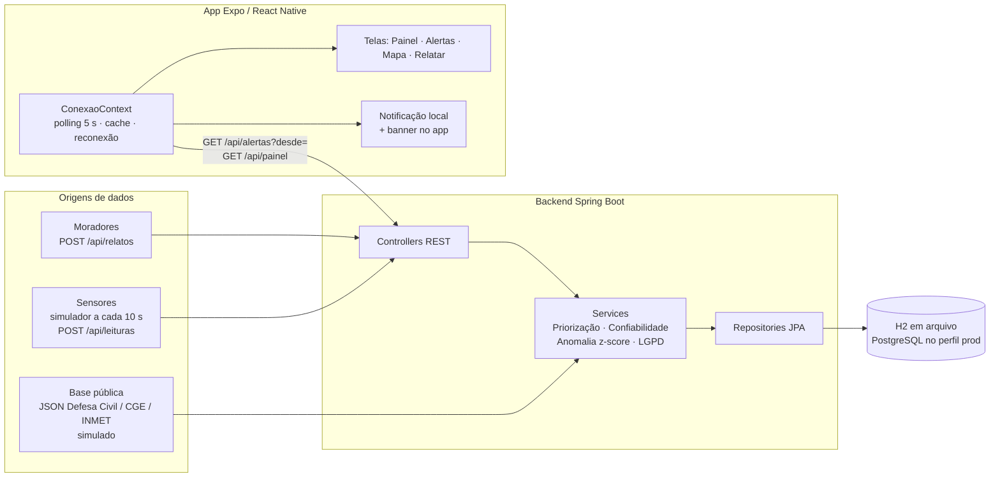

**Repositório único** com as duas stacks:

```
/
├── backend/            Spring Boot (Maven Wrapper)
│   └── src/main/java/com/fiap/ec/urbanrisk/
│       ├── controller/   endpoints REST (Alertas, Eventos, Relatos, Leituras, Painel, ...)
│       ├── service/      regras de negócio: PriorizacaoService, ConfiabilidadeService,
│       │                 EventoService, LeituraService, RelatoService, LgpdService,
│       │                 BasePublicaService, SimuladorSensoresService, EstimadorRisco
│       ├── repository/   Spring Data JPA (consultas derivadas e Specification)
│       ├── model/        entidades JPA e enums (Evento, Regiao, Sensor, Leitura, RelatoComunitario...)
│       ├── dto/          o que a API expõe (nunca a entidade direto)
│       ├── exception/    exceções próprias + @RestControllerAdvice ({"erro": "..."})
│       └── config/       DataLoader, CORS, Swagger, Clock
├── mobile/             Expo / React Native
│   └── src/
│       ├── screens/      Inicio, Painel, Alertas, Mapa, Relatar, DetalheAlerta
│       ├── components/   AlertaCard, NivelBadge, BannerConexao, BannerNovoAlerta, MapaEventos...
│       ├── context/      ConexaoContext (tempo real) e PerfilContext
│       ├── hooks/        useAlertasTempoReal, useAgora
│       ├── services/     api.ts (axios) + um service por recurso + cache + notificações
│       ├── navigation/   tipos das rotas e abas
│       ├── styles/       um *.styles.ts por tela/componente + tema
│       ├── interfaces/ types/ utils/
│       └── __tests__/
├── docs/               api.http (todas as requisições), prints do app e vídeo de demonstração
└── docker-compose.yml
```

**Camadas do backend:** `controller` (HTTP, validação de entrada) → `service` (regras) → `repository` (acesso a dados) → `model` (entidades). Os controllers só falam com services e só devolvem DTOs.

**Camadas do app:** `screens` (telas) → `hooks/context` (estado e tempo real) → `services` (HTTP, cache, notificação) → `utils` (funções puras, testáveis).

---

## Tecnologias

| Stack | Tecnologia | Versão |
|---|---|---|
| Backend | Java | 21 |
| | Spring Boot (Web MVC, Data JPA, Validation, Actuator) | 4.0.3 |
| | H2 Database (arquivo) / PostgreSQL (perfil `prod`) | gerenciado pelo Spring Boot |
| | springdoc-openapi (Swagger UI) | 3.0.2 |
| | JUnit 5, Mockito, MockMvc | gerenciado pelo Spring Boot |
| | Maven Wrapper | 3.9.12 |
| App | Expo SDK | 54 |
| | React Native / React | 0.81.5 / 19.1.0 |
| | TypeScript | 5.9 |
| | React Navigation (native stack + bottom tabs) | 7 |
| | axios, AsyncStorage, expo-notifications, react-native-maps | versões do Expo 54 |
| | Jest (jest-expo) + Testing Library | 29 / 13 |
| Ambiente | Node.js | LTS (testado com 22) |

---

## Como executar o backend

Pré-requisito: **JDK 21** (não precisa instalar Maven, o projeto usa o Maven Wrapper).

```bash
cd backend
./mvnw spring-boot:run          # Linux / macOS
mvnw.cmd spring-boot:run        # Windows
```

- API: **http://localhost:8080**
- Saúde: http://localhost:8080/health (e http://localhost:8080/actuator/health)
- **Swagger UI:** http://localhost:8080/swagger-ui.html
- **Console H2:** http://localhost:8080/h2-console
  - JDBC URL: `jdbc:h2:file:./data/urbanrisk` · usuário: `sa` · senha: em branco

Na primeira subida o `DataLoader` cria **8 bairros** (Lapa, Mooca, Itaim Paulista, Jardim Pantanal, Butantã, Centro, Vila Prudente, Santo Amaro), **12 sensores** com histórico, importa a **base pública simulada** e cria **2 relatos fictícios**. O **simulador** começa a mandar leituras a cada 10 s (desligue com `app.simulador.enabled=false` em `application.properties`).

Para gerar um alerta na hora (útil na apresentação):

```bash
curl -X POST http://localhost:8080/api/simulador/pico/PLU-02
```

Para começar do zero, pare o backend e apague a pasta `backend/data/`.

**Com Docker (opcional):** `docker compose up --build` na raiz sobe o backend na porta 8080 com volume para o banco.

---

## Como executar o app

Pré-requisito: **Node.js LTS**. Para celular, o app **Expo Go** (Android/iOS).

```bash
cd mobile
npm install
npx expo start
```

Depois: tecla **`w`** abre no navegador (Expo Web), **`a`** abre no emulador Android, ou leia o **QR code** com o Expo Go no celular.

### Para onde o app aponta (URL da API)

Não precisa editar código. O app escolhe nesta ordem (`src/services/api.ts`):

| Onde o app roda | URL usada | O que fazer |
|---|---|---|
| Expo Web / simulador iOS | `http://localhost:8080` | nada |
| Emulador Android | `http://10.0.2.2:8080` | nada |
| **Celular físico com Expo Go** | IP da máquina que roda o Expo, porta 8080 | nada (celular e computador na **mesma rede Wi-Fi**; libere a porta 8080 no firewall) |
| Qualquer caso, forçando | o valor informado | `EXPO_PUBLIC_API_URL=http://192.168.0.10:8080 npx expo start` ou preencha `expo.extra.apiUrl` no `app.json` |

**Observações:** a notificação local funciona no Expo Go (Android e iOS); no navegador o aviso aparece como **banner dentro do app**. O mapa (`react-native-maps`) funciona no Expo Go; no navegador a aba Mapa mostra os alertas **agrupados por região**.

---

## Como rodar os testes

**Backend** (47 testes: JUnit 5 + MockMvc):

```bash
cd backend
./mvnw test            # Windows: mvnw.cmd test
```

| Classe | O que verifica |
|---|---|
| `PriorizacaoServiceTest` | score sobe com severidade e confiança, cai com o tempo, corroboração aumenta, limites exatos dos níveis (74,9 → ALTO, 75 → CRÍTICO...), pesos somam 1, motivo explicável |
| `DeteccaoAnomaliaTest` | série normal não dispara, pico dispara, queda brusca dispara, poucas amostras e série constante não quebram |
| `ConfiabilidadeServiceTest` | regras de confiança por origem, confirmações com teto, bônus de sensor |
| `EstimadorRiscoPadraoTest` | severidade por tipo de sensor e texto em linguagem simples |
| `LgpdServiceTest` | hash SHA-256 com salt, normalização do contato, arredondamento da localização |
| `AlertaControllerTest` (MockMvc) | `GET /api/alertas` ordenado, filtro por tipo, paginação, `?desde=`, 404 com `{"erro"}`, `POST /api/relatos` inválido → 400, relato não devolve contato, confirmação sobe a confiança e não repete, leitura acima do limite vira alerta, resolver alerta, painel, regiões e sensores |

**App** (14 testes: jest-expo + Testing Library):

```bash
cd mobile
npm test
npx tsc --noEmit       # checagem de tipos
```

| Arquivo | O que verifica |
|---|---|
| `utils.test.ts` | "há X min", cor/texto por nível, quem notifica, backoff 5/10/20/30 s, mesclagem incremental, leitura do `{"erro"}` |
| `AlertaCard.test.tsx` | o card mostra nível em texto, origem, % de confiança, motivo e tem rótulo de acessibilidade |
| `ConexaoContext.test.tsx` | com a API respondendo fica `online`; quando a API cai vai para `offline` **sem perder os dados** e mostra o banner; quando volta, reconecta sozinho (`online`) e mostra "Conexão restabelecida" por 3 s |

---

## Endpoints principais

Todas as requisições prontas para usar estão em [`docs/api.http`](docs/api.http) (VS Code REST Client / IntelliJ). Documentação interativa no **Swagger**.

| Método | Rota | Descrição |
|---|---|---|
| GET | `/health` | servidor no ar (usado pelo app para reconectar) |
| GET | `/api/alertas` | alertas **ativos ordenados por prioridade**. Filtros: `tipo`, `regiaoId`, `nivel`, `desde` (ISO-8601), `page`, `size` |
| GET | `/api/alertas/{id}` | detalhe de um alerta |
| GET | `/api/eventos` | todos os eventos, inclusive resolvidos (filtros `status`, `tipo`, `regiaoId`) |
| PATCH | `/api/eventos/{id}/resolver` | agente local marca como resolvido |
| GET | `/api/painel` | resumo: totais por nível e tipo, região mais crítica, última leitura de cada sensor, horário da última atualização |
| POST | `/api/leituras` | sensor envia leitura (`codigoSensor`, `valor`, `dataHora` opcional) |
| POST | `/api/relatos` | morador envia relato (sem nome; contato opcional vira hash) |
| POST | `/api/relatos/{id}/confirmar` | outro morador confirma (header opcional `X-Dispositivo-Id` evita confirmação repetida) |
| GET | `/api/relatos` | relatos sem dado pessoal |
| POST | `/api/importacoes/base-publica` | importa a base pública simulada (idempotente) |
| GET | `/api/regioes` · `/api/sensores` | bairros e sensores (com última leitura) |
| POST | `/api/simulador/pico/{codigoSensor}` | força um pico no simulador (apoio à demonstração) |

Exemplo de alerta devolvido:

```json
{
  "id": 8,
  "tipoRisco": "ALAGAMENTO",
  "regiaoNome": "Mooca",
  "titulo": "Chuva forte e risco de alagamento na Mooca",
  "origem": "SENSOR",
  "nivelConfianca": 85,
  "fonte": "Sensor PLU-02 · Mooca",
  "scorePrioridade": 69.7,
  "nivelAlerta": "ALTO",
  "motivoPrioridade": "Chuva de 47,7 mm/h, limite 30 mm/h (9,3x a média recente) + confiança 85%",
  "status": "ATIVO",
  "atualizadoEm": "2026-11-18T00:13:18Z"
}
```

Erros sempre no formato `{"erro": "mensagem"}` com o status correto (400, 404, 405, 500), sem stack trace.

**Base pública:** é **simulada** (`backend/src/main/resources/dados-publicos/alertas-defesa-civil.json`) para a apresentação não depender de internet. O formato imita alertas de órgãos oficiais. Em produção a fonte real seria a API de alertas da **Defesa Civil do Estado de SP**, os boletins do **CGE** (Centro de Gerenciamento de Emergências Climáticas da Prefeitura) e os avisos meteorológicos do **INMET**, consultados periodicamente pelo mesmo `BasePublicaService`.

---

## Recurso de análise: priorização dos alertas

Implementado em Java puro em [`PriorizacaoService`](backend/src/main/java/com/fiap/ec/urbanrisk/service/PriorizacaoService.java) (testável sem banco).

### 1. Score de prioridade (0 a 100)

```
score = 100 × ( 0,35 × severidade
              + 0,25 × confiança
              + 0,15 × impacto
              + 0,15 × recência
              + 0,10 × corroboração )
```

| Fator | Como é calculado (0 a 1) | Por que esse peso |
|---|---|---|
| **Severidade** (35%) | o quanto a leitura passou do limite (`EstimadorRisco`). Chuva/energia: 0,8× do limite = 0 e 2× = 1; rio: 0,9× = 0 e 1,4× = 1; temperatura: 2 °C abaixo do limite = 0 e 6 °C acima = 1. Base pública: severidade do órgão (baixa 0,3 · moderada 0,6 · alta 0,85 · extrema 1). Relato: 0,45 + 0,05 por confirmação (até 0,8) | é o que mais define o perigo real |
| **Confiança** (25%) | `nivelConfianca / 100` (ver seção seguinte) | alerta pouco confiável não pode passar na frente de um confirmado |
| **Impacto** (15%) | população estimada da região ÷ 500 mil (máx. 1) | mais gente exposta, mais urgente |
| **Recência** (15%) | `0,5 ^ (horas desde a última evidência ÷ 3)`: meia-vida de 3 h | evento sem novidade perde prioridade sozinho |
| **Corroboração** (10%) | origens diferentes apontando o mesmo risco na mesma região nas últimas 2 h: 1 origem = 0 · 2 = 0,6 · 3 = 1 | sensor + órgão público + moradores concordando reduz falso alarme |

O score é recalculado a cada nova evidência e a cada 60 s (por causa da recência). Eventos sem novidade por 12 h são encerrados automaticamente.

### 2. Níveis de alerta

| Nível | Score | Justificativa |
|---|---|---|
| **CRÍTICO** | ≥ 75 | só chega aqui com severidade alta **e** fonte confiável (ex.: chuva 2× o limite num sensor ativo na Mooca ≈ 82) |
| **ALTO** | 55 a 74,9 | leitura acima do limite em sensor confiável, alerta oficial moderado, ou relato já confirmado por vizinhos |
| **MODERADO** | 35 a 54,9 | leitura no limite, relato novo sem confirmação (≈ 50), aviso oficial de baixa severidade |
| **BAIXO** | < 35 | evento antigo ou de baixa severidade/confiança |

Só **ALTO** e **CRÍTICO** geram notificação no celular, para o morador não se acostumar a ignorar avisos. As constantes ficam em `PriorizacaoService` (`LIMITE_CRITICO`, `LIMITE_ALTO`, `LIMITE_MODERADO`) e os limites de borda são testados.

### 3. Detecção de anomalia (z-score)

Cada leitura é comparada com as **últimas 20 leituras do mesmo sensor** (média móvel):

```
z = (valor − média) / desvio padrão
```

- `|z| > 2,5` marca a leitura como **anômala** (é guardada em `Leitura.anomalia` e `zScore`).
- Uma leitura vira evento se **passar do limite** do sensor **ou** se for **anômala e estiver acima de 60% do limite** (pega a subida rápida antes de estourar o limite).
- Com menos de 5 amostras o z-score é 0 (sem base para comparar); o desvio tem um piso para não explodir em séries quase constantes.

### 4. Alerta explicável

Todo alerta traz `motivoPrioridade`, por exemplo: *"Chuva de 47,7 mm/h, limite 30 mm/h (9,3x a média recente) + 2 origens confirmam + confiança 85%"*. O app mostra esse texto no card ("Por que é prioridade").

### Ponte com a GS de Inteligência Artificial e Computacional

Na disciplina de IA o grupo treinou um modelo de **regressão linear de risco de inundação** (dataset Kaggle Playground S4E5, **MAE 0,0157**, faixas de risco **0,480 / 0,525**) publicado com uma interface Gradio. A severidade de alagamento aqui passa pela interface [`EstimadorRisco`](backend/src/main/java/com/fiap/ec/urbanrisk/service/EstimadorRisco.java):

- implementação padrão: `EstimadorRiscoPadrao` (regra em Java, sem dependência externa);
- alternativa: uma classe `EstimadorRiscoModeloIA` que faz `POST` para o serviço Python (Gradio/FastAPI) com as variáveis da região e converte a probabilidade prevista em severidade (abaixo de 0,480 = baixa, acima de 0,525 = alta). Basta registrá-la como `@Primary` para trocar a regra pelo modelo, sem mudar o resto do sistema.

---

## Origem e nível de confiança

Todo alerta informa `origem` (`SENSOR`, `BASE_PUBLICA`, `COMUNITARIO`), `nivelConfianca` (0 a 100) e `fonte` (ex.: *"Sensor PLU-03 · Jardim Pantanal"*, *"Base pública Defesa Civil SP (simulada) · DC-SP-2026-1187"*, *"Relato comunitário · 4 confirmações"*). Regras em [`ConfiabilidadeService`](backend/src/main/java/com/fiap/ec/urbanrisk/service/ConfiabilidadeService.java):

| Origem | Regra |
|---|---|
| **Sensor** | base **85**; −25 se a última leitura tem mais de 5 min; até −20 se mais de 30% das leituras da última hora foram anômalas (sensor oscilando, possível defeito); sensor inativo = 30 |
| **Base pública oficial** | **90** |
| **Relato comunitário** | base **40**, **+10 por confirmação** de outro morador (até 85), **+15** se houver alerta de **sensor** na mesma região para o mesmo tipo de risco |

---

## Escalabilidade, disponibilidade e proteção de dados

### Escalabilidade
- **API sem estado** (nenhuma sessão no servidor): dá para subir várias instâncias atrás de um **load balancer** (Nginx, AWS ALB) sem afinidade de sessão.
- **Paginação** em todas as listas (`page`, `size`, máximo 200).
- **Consulta incremental** `GET /api/alertas?desde=`: o app só baixa o que mudou desde a última consulta (e a lista completa a cada ~1 min para corrigir diferenças), em vez de baixar tudo a cada 5 s.
- **Índices** (`@Index`) nas colunas de filtro e ordenação: `status + scorePrioridade`, `atualizadoEm`, `regiao + tipoRisco`, `nivelAlerta`, `sensor + dataHora`.
- **Retenção**: leituras com mais de 24 h são apagadas (o histórico longo iria para um data lake).
- Perfil **`prod`** (`application-prod.properties`) com **PostgreSQL**, pool de conexões e simulador desligado. `Dockerfile` e `docker-compose.yml` prontos para container.
- **Simulador e jobs agendados**: com várias instâncias, o simulador fica só nos ambientes de teste e os jobs (`@Scheduled`) rodariam em uma instância só (ShedLock) ou num worker separado.
- **Evolução**: trocar o polling por **SSE/WebSocket** (servidor empurra o alerta) e colocar uma fila (Kafka/RabbitMQ) na entrada dos sensores.

### Disponibilidade
- `GET /health` e **Spring Boot Actuator** (`/actuator/health`, com probes `liveness`/`readiness`).
- **Tratamento global de erros** (`ApiExceptionHandler`): nenhum 500 com stack trace chega ao cliente (`server.error.include-stacktrace=never`).
- **App resiliente**: guarda o último dado em **cache local** (AsyncStorage), mostra o cache ao abrir sem servidor, **não trava** quando o backend cai, mostra o banner vermelho e **reconecta sozinho** com **backoff** (5 s, 10 s, 20 s, depois 30 s) usando `healthCheck()`.
- Timeouts curtos (axios 5 s, health 3 s) para perceber a queda rápido.
- **Dados persistentes** (H2 em arquivo): reiniciar o backend não perde alertas.
- `Dockerfile` com usuário sem privilégio e `restart: unless-stopped` no compose.

### Proteção de dados pessoais (LGPD, Lei 13.709/2018)
- **Minimização**: o relato **não pede nome**. Contato (telefone/e-mail) é **opcional** e só serve para retorno.
- O contato é guardado **só como hash SHA-256 com salt** (`LgpdService`), normalizado (o mesmo telefone em formatos diferentes gera o mesmo hash). **Nunca é devolvido pela API**; o DTO público só diz `contatoInformado: true/false`.
- **Retenção**: um job diário apaga o hash de contato de relatos com mais de **30 dias**.
- **Localização reduzida**: a coordenada do relato é arredondada para 2 casas (~1 km) antes de salvar, e na resposta pública o relato aparece no **centro do bairro**.
- O id do aparelho usado para evitar confirmação repetida também vira **hash**.
- **DTOs** em todas as respostas (a entidade nunca sai direto); **Bean Validation** em toda entrada; **CORS** configurável por ambiente (`app.cors.origens`); salt por variável de ambiente (`URBANRISK_SALT`) em produção.
- O app explica isso ao morador, em linguagem simples, na própria tela de relato.
- Todos os dados de exemplo são **fictícios**.

---

## Indicadores

### Tempo de atualização
- **Polling de 5 s** (`ConexaoContext`) com `?desde=`. Escolhemos polling porque é simples, funciona igual no Expo Go e no Expo Web, atravessa qualquer proxy/firewall e **reconecta sem lógica extra** (a próxima requisição já é a reconexão). SSE ou WebSocket ficam como evolução para escala maior.
- O painel mostra **"Atualizado há Xs"** correndo em tempo real, o tempo de resposta do servidor e quanto o último alerta novo levou para chegar à tela.
- **Medido** (Expo Web + backend local, 18/11/2026, 3 alertas forçados com `POST /api/simulador/pico`): do pico no sensor até o alerta aparecer no app levou **2,8 s, 2,8 s e 3,8 s** (média **3,2 s**; máximo teórico ≈ 5 s + tempo de resposta). Resposta típica do servidor: **8 a 20 ms**. Banner de "sem conexão" depois de parar o backend: **0,2 a 0,3 s** nos testes (no pior caso, até o próximo ciclo de 5 s + timeout). Reconexão depois de religar o backend: **13 s** (inclui ~6 s de subida do Spring Boot e a espera do backoff), sem tocar no app.

### Qualidade dos alertas
- **Priorização** por score com 5 fatores e níveis com limites justificados.
- **Confiança** por origem e **corroboração** entre origens (sensor + órgão + moradores).
- **Explicação** (`motivoPrioridade`) em todo alerta.
- **Sem duplicidade**: o mesmo sensor atualiza o mesmo evento enquanto o problema dura; a base pública é importada por código (idempotente); o app **não notifica o mesmo alerta duas vezes** (ids guardados no aparelho) e não notifica o próprio relato de quem enviou; o mesmo aparelho não confirma um relato duas vezes.
- Detecção de **anomalia** por z-score antecipa alertas e reduz confiança de sensor com leitura irregular.

### Facilidade de uso
- 4 abas fixas (**Painel, Alertas, Mapa, Relatar**) e tela inicial com só duas escolhas: **"Sou morador"** ou **"Sou agente local"** (sem login).
- Linguagem simples ("Chuva forte e risco de alagamento na Mooca", "Risco alto", "confiança média").
- **Acessibilidade**: nível sempre com **texto + ícone + cor** (nunca só cor), `accessibilityLabel`/`accessibilityRole` em botões, cards, banners e abas, textos de no mínimo 16 pt que respeitam o tamanho de fonte do sistema, alvos de toque de 48 pt, contraste alto (texto branco sobre azul-petróleo, vermelho e laranja escuros), banners com `accessibilityLiveRegion` para leitores de tela.
- Relato em 4 passos com botões grandes; só tipo e bairro são obrigatórios.
- O agente local vê o botão **"Marcar como resolvido"**; o morador vê **"Confirmar este relato"**.

---

## Roteiro rápido de teste

1. Suba o backend (`cd backend && ./mvnw spring-boot:run`) e abra http://localhost:8080/swagger-ui.html. Em `GET /api/alertas`, veja a lista **ordenada por `scorePrioridade`** com `origem`, `nivelConfianca`, `fonte` e `motivoPrioridade`.
2. Suba o app (`cd mobile && npm install && npx expo start`, tecla `w` ou QR code). Escolha **"Sou agente local"**.
3. No **Painel**, veja "Atualizado há Xs" mudando. Rode `curl -X POST http://localhost:8080/api/simulador/pico/PLU-02`: em até ~5 s aparece o banner **"Novo alerta"** (e a notificação no celular) e o alerta entra na aba **Alertas**.
4. Na aba **Relatar**, envie um alagamento na Mooca. Abra o aviso e toque em **"Confirmar este relato"**: a confiança sobe de 40% para 50% (outras confirmações via `POST /api/relatos/{id}/confirmar`).
5. **Pare o backend** (Ctrl+C). Em poucos segundos aparece o banner vermelho **"Sem conexão com o servidor. Mostrando dados de HH:MM. Tentando reconectar..."**. Navegue pelas abas: os dados continuam na tela.
6. **Religue o backend**. Sem mexer no app, aparece o banner verde **"Conexão restabelecida"** e os alertas voltam a atualizar sozinhos.
7. Rode os testes: `./mvnw test` no backend e `npm test` no app.

---

## Prints do app

Capturados no Expo Web (largura de celular) com o backend rodando. Arquivos em [`docs/prints/`](docs/prints).

| Início | Painel | Alertas |
|---|---|---|
| 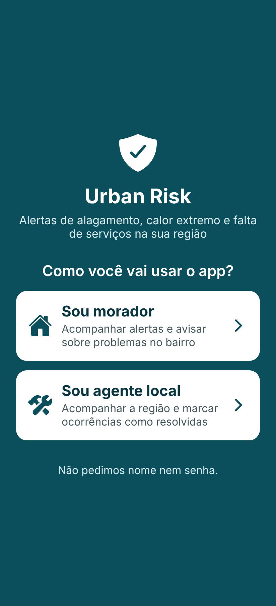 | 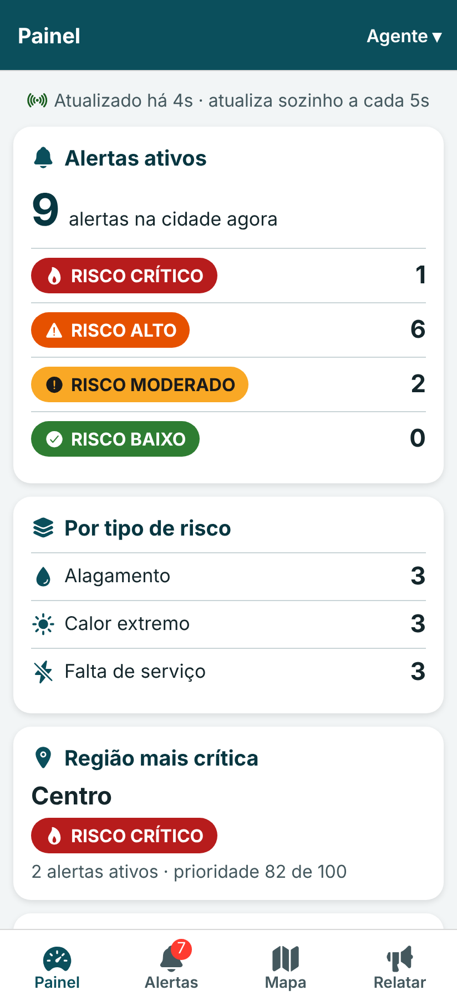 | 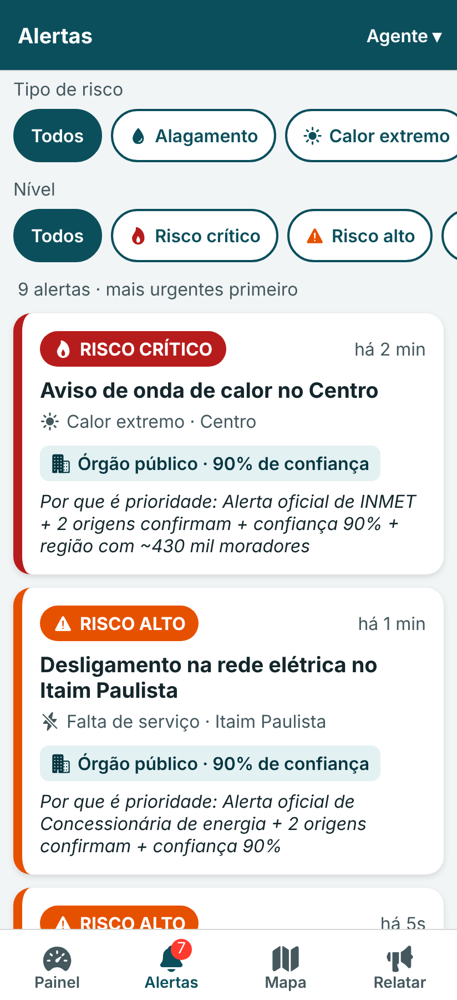 |

| Relatar | Detalhe + confirmação | Novo alerta em tempo real |
|---|---|---|
| 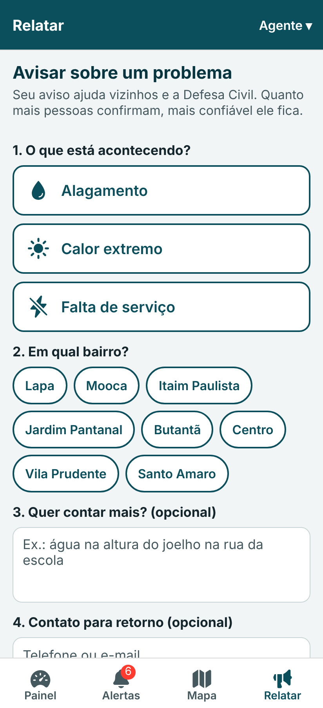 | 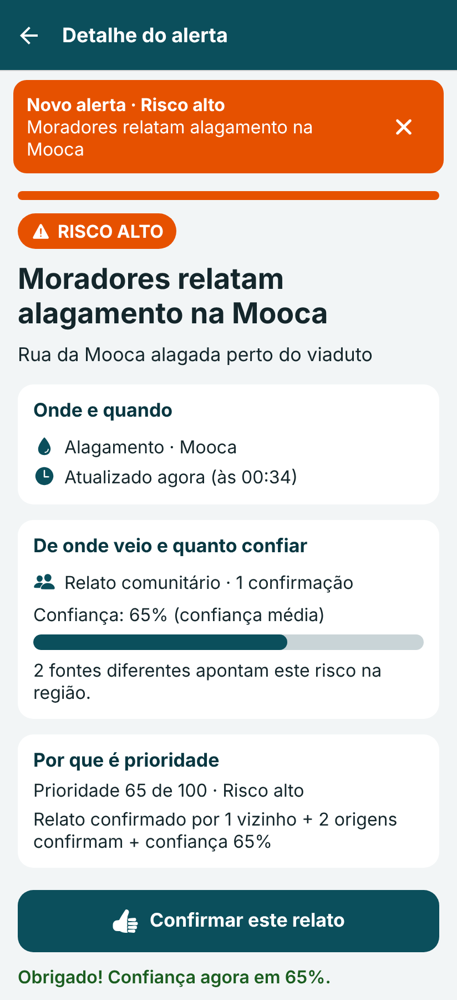 | 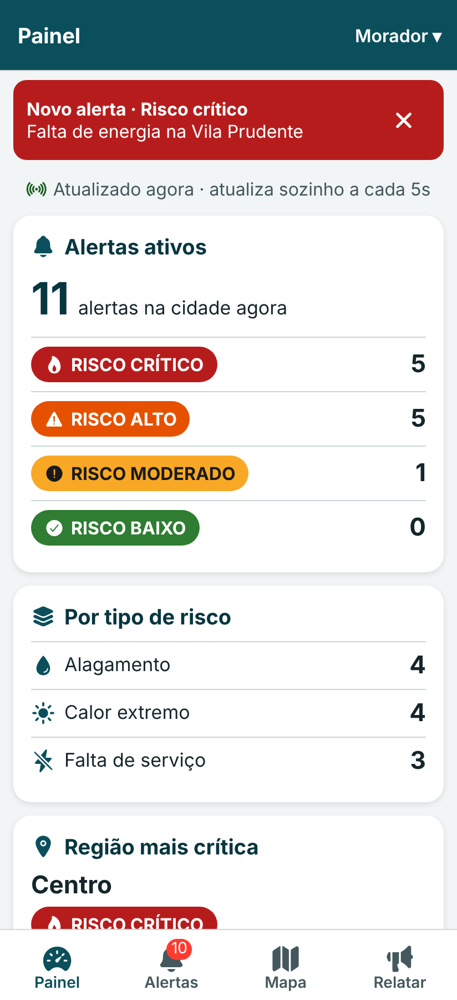 |

| Backend parado (sem conexão) | Painel com cache offline | Backend religado |
|---|---|---|
| 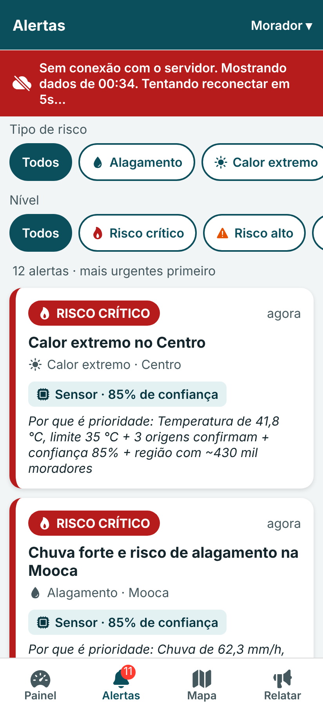 | 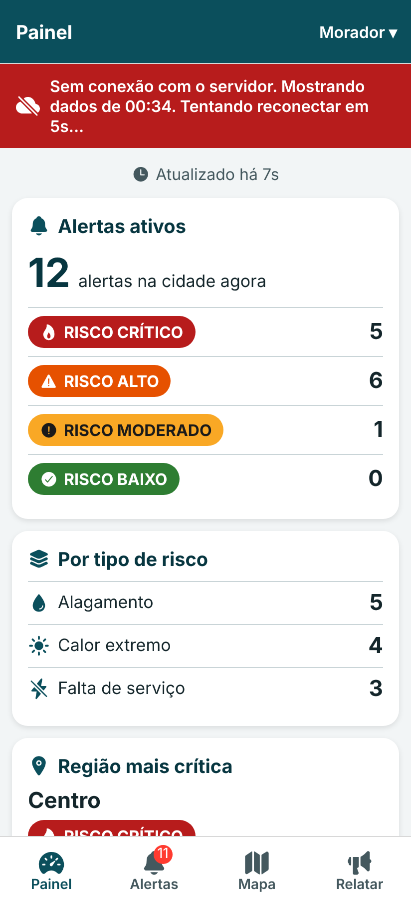 | 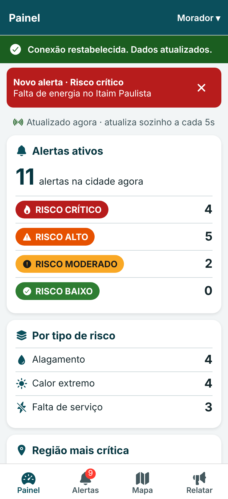 |

| Tempo de atualização | Mapa no navegador (agrupado por região) |
|---|---|
| 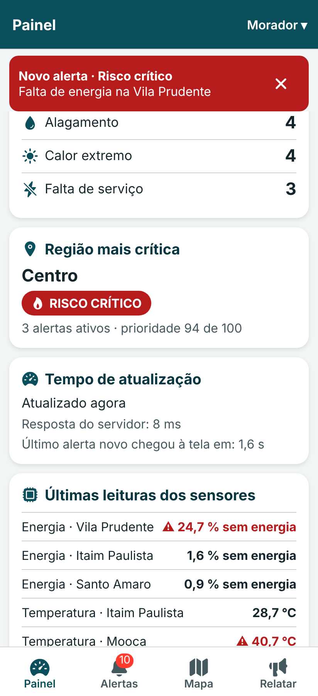 | 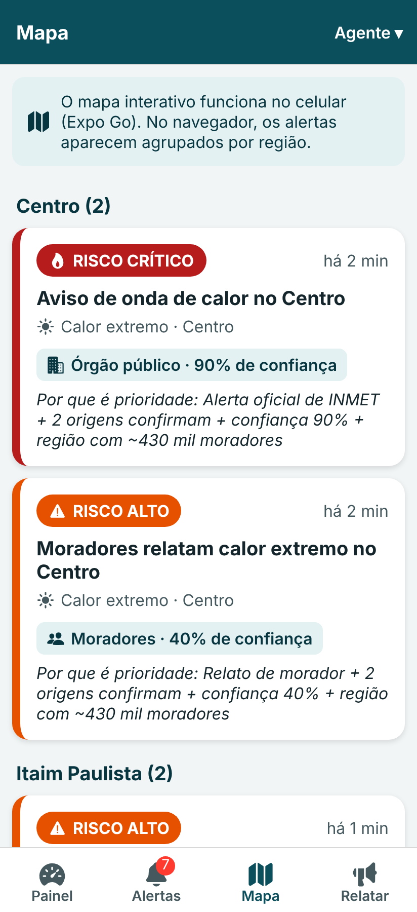 |
